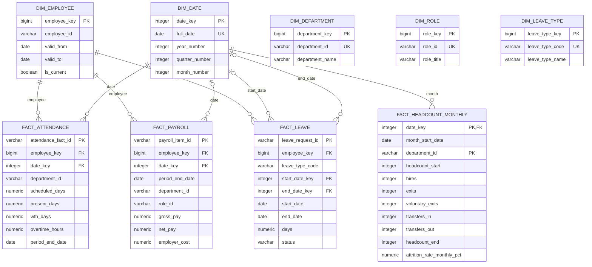

# PulseIQ Analytics Warehouse ? Star Schema Diagram

The diagram shows the enforced employee/date relationships in the current SQL schema. Department, role, and leave-type business identifiers in fact tables are not represented as enforced foreign keys.

