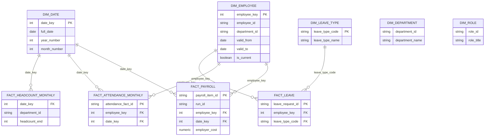

# PulseIQ Analytics Warehouse — Task 2

## 1. Overview

The analytics warehouse uses PostgreSQL and the `dw` schema. Data is loaded from `data/clean/pulseiq_cleaned.xlsx` by `src/load_dw.py`. The loader uses upserts so repeated runs update existing records instead of creating duplicates.

## 2. Schema diagram



The diagram shows the main analytical relationships. Department and role identifiers are also retained in the relevant warehouse tables.

## 3. Fact table grains

- **fact_payroll:** One row per payroll item for an employee in a payroll run.
- **fact_attendance_monthly:** One row per employee per monthly attendance period.
- **fact_leave:** One row per leave request.
- **fact_headcount_monthly:** One row per department per monthly reporting period.

## 4. Employee history and transfers

`dim_employee` contains versioned employee records. Each version has an `employee_key` surrogate key, an employee identifier, a department, validity dates, and a current-version flag.

Transfer test: EMP-0002 has historical versions in department D01 through 2023-07-17 and a version in department D08 beginning 2023-07-18. Historical facts must use the appropriate version-specific `employee_key` to preserve department history.

The provided workbook contains a versioned `dim_employee` sheet rather than a separate `employee_assignments` sheet, so that sheet was used as the source for employee history.

## 5. Loading and repeat safety

Run the loader from the project root:

```powershell
python .\src\load_dw.py
```

The loader uses upserts and loads dimensions before facts. Two consecutive runs produced identical row counts:

| Table | Rows |
|---|---:|
| dw.dim_department | 11 |
| dw.dim_role | 58 |
| dw.dim_date | 2557 |
| dw.dim_leave_type | 6 |
| dw.dim_employee | 1606 |
| dw.fact_payroll | 7342 |
| dw.fact_attendance_monthly | 7343 |
| dw.fact_leave | 3441 |
| dw.fact_headcount_monthly | 891 |

Two payroll records with unknown employee keys were skipped because their employee keys were not present in `dw.dim_employee`. The source data was not silently modified to invent missing employees.

## 6. Indexes

Indexes are defined in `sql/dw_schema.sql` for relevant employee, date, payroll run, period, and join-key lookups.

## 7. Reconciliation checks

The following checks passed against the provided reference data:

| Check | Actual result | Expected result | Status |
|---|---:|---:|---|
| Employer cost for run PR-2025-04 | 53,363,392.08 | 53,363,392.08 | PASS |
| Distinct employees paid in PR-2026-09 | 444 | 444 | PASS |
| Department D00, April 2025 employer cost | 480,809.00 | 480,809.00 | PASS |
| Department D00, April 2025 gross pay | 479,009.00 | 479,009.00 | PASS |
| Department D00, April 2025 employees paid | 1 | 1 | PASS |

The department-month comparison uses the D00 row for April 2025 from `reference_summary_dept_month`.

## 8. Implementation files

- `sql/dw_schema.sql` — warehouse schema and indexes.
- `src/load_dw.py` — repeat-safe warehouse loader.
- `docs/warehouse-schema.md` — schema diagram, table grains, loading notes, and reconciliation evidence.
</escape>
